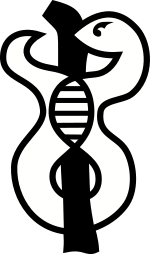

<table><tr><td></td>
 <td><h1> Treehouse Comparative Analysis of RNA Expression (CARE)</h1> 
 <a href="http://treehousegenomics.ucsc.edu">UCSC Treehouse Childhood Cancer Initiative</a>
</td></tr></table>

Documentation is in progress; the interface of this program is in active development. 

## Running CARE on my own focus sample
To compare your own RNA-seq sample to the Treehouse Compendium, you will need an rsem\_genes.results file that has been generated
by a pipeline equivalent to that used by the [Toil RNAseq Recompute](https://xenabrowser.net/datapages/?host=https%3A%2F%2Ftoil.xenahubs.net).
Treehouse provides such a pipeline in our [pipelines respository](https://github.com/UCSC-Treehouse/pipelines).
While files generated by other RSEM pipelines may be accepted as input by CARE, because they were not created in a comparable manner, any outliers
found may not be truly supported by the underlying data.

### Run Treehouse Pipelines
Follow the instructions on the [Trehouse Pipelines repository](https://github.com/UCSC-Treehouse/pipelines) with your own FASTQ files to generate an `outputs/` directory tree.

### Rename output directories
(Replace SAMPLE\_ID with your sample's identifier in all that follows)
 - Extract the files under `outputs/expression/SAMPLE_ID.tar.gz` and place directly in the `expression` parent dir. (`expression` will then contain dirs `RSEM`, `Kallisto`, `QC`).
 - Rename parent dirs as follows:
    - `outputs` -> `secondary`
    - `expression` -> `ucsc_cgl-rnaseq-cgl-pipeline-0.0.0-0000000`
    - `fusion` -> `ucsctreehouse-fusion-0.0.0-0000000`
    - `qc` -> `ucsctreehouse-bam-umend-qc-0.0.0-0000000`
    - `variants` -> `ucsctreehouse-mini-var-call-0.0.0-0000000`

### Place in CARE input dir
Create a `SAMPLE_ID` dir inside the `inputs` dir of CARE. Then, move your `secondary` dir containing
the input data into that `SAMPLE_ID` dir.

### Create manifest
Edit the `manifest.tsv` file in the CARE base directory to replace the test sample with your own samples. The first column contains your SAMPLE\_ID;
then, separated by a tab character, the second column contains the "harmonized diagnosis" of your focus sample. This diagnosis
should match one of those found in the "disease" column of the compendium clinical data. For example, the clinical data for
the Tumor Compendium V10 Public PolyA can be found [here on UCSC Xena
](https://xenabrowser.net/datapages/?dataset=clinical_TumorCompendium_v10_PolyA_2019-07-25.tsv&host=https%3A%2F%2Fxena.treehouse.gi.ucsc.edu%3A443).
If no diagnoses match that of your sample, you may leave it blank and the "pan-disease" outlier analysis will be skipped.

### Run CARE
`make run` will now run your desired sample. When complete, results will be available in `outputs/SAMPLE_ID`.

## Interpreting the output
### Jupyter Notebooks
Each step of the analysis produces a Jupyter Notebook containing the code that has been executed.
You can use the [Jupyter software](https://jupyter.org/install) or [nbviewer](https://nbviewer.jupyter.org/) to inspect them.

### JSON files
The programmatic output of each Jupyter Notebook is stored in the correspondingly-numbered JSON file.

### HTML files
The JSON files are summarized into a human-readable format, Summary.html and Slides.html. These documents are automatically
populated with the high-level results of the analysis, but need human intervention to display the clinical data.

## Customizing the HTML summary and slides
Output for this code includes Summary.html and Slides.html documents. When you first open them, they will have some values populated
but in general they will be full of placeholder text.
The key to populating them is the annotations.json file.
When this file is in the same directory as the HTML file, its contents will be inserted into the HTML file via JavaScript.
Update the values in annotations.json, save it, and refresh the HTML file to see your changes appear.

In addition, creating images with certain names will cause them to appear in predetermined locations in the Summary and Slides:
- pathway.png : pathway diagram
- tumormap.png : tumormap image

## Data requirements
If the RNA-Seq data does not contain enough informative reads, meaningful comparisons cannot be made with our compendium. We assess whether reads are informative by determining whether they are Mapped, Exonic, and Non-duplicate (MEND) reads. To determine whether an RNA-Seq dataset contains enough MEND reads, check the first page of Summary.html, which reports whether the sample passes or fails MEND QC, which requires 10 million MEND reads. 

Following is an example of a dataset that failed MEND QC. The dataset contained 0.7 million MEND reads, and the QC tables on the first page of Summary.html reports "FAIL" for MEND QC. While that data had plenty of total reads (17 million), 81% are duplicates (page 25, "Metrics"). MEND reads are described [here](https://academic.oup.com/gigascience/article/10/3/giab011/6169410).

The analysis reported no pan-disease outliers, but we would also recommend that one also be skeptical of the pan-cancer outlier results. Too few genes were measured due to the lack of informative reads. The low number of measured genes causes each gene's allotment of TPM (which we think of as slices of a pie: fewer slices = bigger slices) to be larger than in most samples. The Metrics section of Summary.html reported that 19.73 thousand genes were measured in the dataset, while the typical range is 24.76 - 29.7. The analysis returned 606 pan cancer up-outliers, while the typical range is 97.04 - 285.05. Together with the low MEND read count, these indicate that the pan-cancer results are a result of technical variation, not biological variation.

The specific reason no pan-disease outliers were reported is that only one of the four personalized cohorts has any members. For example, in the "Diagnosis Composition of Personalized Cohorts" section, one row contains "First-Degree MCS" in the left column, and "Total —0 (Below minimum size; does not contribute to outlier analysis)" in the right column.

CARE uses consensus based identification of pan-disease outliers, requiring that the gene is an outlier relative to at least 2 cohorts. That is why CARE reports no pan-disease results for the sample.

The three cohorts with no samples are all based on correlation. In the "Most Correlated Samples with Clinical info" section, the highest correlation was 0.35. That is an exceptionally low correlation. We usually consider correlation scores in the top 5% of all correlation scores among all samples; the threshold for the top 5% for the v10 polyA compendium is 0.874. This is another indication that the RNA-Seq data for your sample is not comparable to the compendium.
